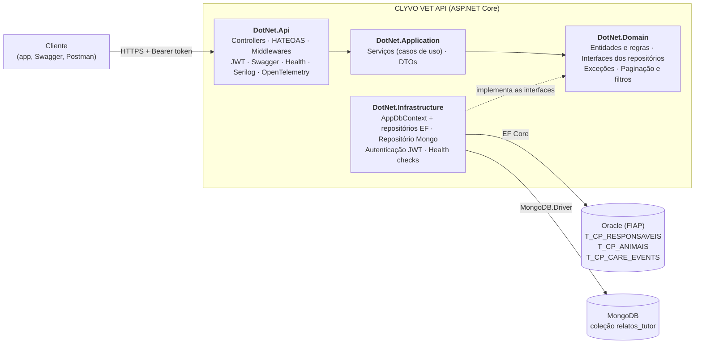

# CLYVO VET API

API REST em ASP.NET Core para o acompanhamento contínuo do cuidado de cães e gatos.
Entrega da **4ª Sprint** da disciplina *Advanced Business Development with .NET* (Challenge FIAP 2026, 2TDS).

## Integrantes

| Nome | RM |
|---|---|
| Ana Carolina Pereira Fontes | 562145 |
| João Victor Nascimento Adão | 563409 |
| Johnny Dias Mathias Junior | 566516 |
| Luisa Ganasevici de Abreu | 563403 |
| Matheus Moya de Oliveira | 562822 |

---

## Sumário

1. [Visão geral](#1-visão-geral)
2. [Tecnologias](#2-tecnologias)
3. [Arquitetura](#3-arquitetura)
4. [Modelo de dados](#4-modelo-de-dados)
5. [Endpoints](#5-endpoints)
6. [Paginação, filtros, ordenação e HATEOAS](#6-paginação-filtros-ordenação-e-hateoas)
7. [Autenticação e autorização (JWT)](#7-autenticação-e-autorização-jwt)
8. [Tratamento de erros](#8-tratamento-de-erros)
9. [Monitoramento e observabilidade](#9-monitoramento-e-observabilidade)
10. [Testes e cobertura](#10-testes-e-cobertura)
11. [Como executar](#11-como-executar)
12. [Evidências](#12-evidências)
13. [Decisões técnicas](#13-decisões-técnicas)
14. [Segurança](#14-segurança)
15. [Mapa dos requisitos da Sprint 4](#15-mapa-dos-requisitos-da-sprint-4)

---

## 1. Visão geral

A jornada de saúde do pet costuma ser fragmentada: o tutor só procura o veterinário em situações pontuais (vacina, sintoma, emergência), e o histórico fica espalhado. Isso gera vacinas e retornos esquecidos e pouca continuidade no tratamento.

A CLYVO VET API é o núcleo back-end da solução. Ela permite:

- cadastrar **responsáveis** (tutores) e os seus **animais**;
- registrar **eventos de cuidado** (vacina, consulta, exame, cirurgia...), com status, prioridade e conclusão;
- registrar **relatos do tutor**: textos livres sobre o dia a dia do animal ("comeu pouco e ficou deitado"), com uma lista de sintomas. Esses relatos alimentam a camada de IA do projeto (NLP), de outra disciplina.

Os dados estruturados (responsáveis, animais e eventos) ficam no **Oracle**, e os relatos, que têm formato livre, ficam no **MongoDB**. O MVP atende cães e gatos, com a arquitetura preparada para outras espécies.

```text
Responsável 1 ── N Animal 1 ── N Evento de cuidado     (Oracle)
                   Animal 1 ── N Relato do tutor       (MongoDB)
```

---

## 2. Tecnologias

| Tecnologia | Uso no projeto |
|---|---|
| C# / .NET 10 · ASP.NET Core Web API | Linguagem, runtime e API REST |
| Entity Framework Core 10 + `Oracle.EntityFrameworkCore` | ORM e migrations no Oracle |
| Oracle Database (FIAP) | Banco relacional: responsáveis, animais e eventos |
| MongoDB + `MongoDB.Driver` 3.13 | Banco NoSQL: relatos do tutor |
| JWT Bearer (`Microsoft.AspNetCore.Authentication.JwtBearer`) | Autenticação e autorização |
| Swashbuckle (Swagger / OpenAPI) | Documentação interativa, com botão *Authorize* |
| Serilog (console e arquivo) | Logging estruturado com Correlation ID |
| OpenTelemetry | Tracing e métricas |
| Health Checks | `/health` (Oracle) e `/health/mongo` (MongoDB) |
| xUnit, Moq, FluentAssertions | Testes de unidade (padrão AAA) |
| `WebApplicationFactory` + EF Core InMemory | Testes de integração sem banco externo |
| coverlet | Medição de cobertura |
| Docker | MongoDB local para desenvolvimento |

---

## 3. Arquitetura

### 3.1. Diagrama da solução



### 3.2. As quatro camadas (Clean Architecture)

A solução (`src/DotNet.Api.slnx`) é dividida em quatro projetos. A regra central é que **as dependências apontam para dentro**: o Domain não conhece ninguém, e a Infrastructure implementa os contratos que o Domain define.

| Projeto | Responsabilidade | Depende de |
|---|---|---|
| `DotNet.Domain` | Entidades com as próprias validações (`Criar`/`Atualizar`), exceções de domínio, interfaces dos repositórios e tipos de consulta (`ParametrosPaginacao`, `ResultadoPaginado`, filtros) | — |
| `DotNet.Application` | Serviços que orquestram os casos de uso e DTOs de entrada e saída | Domain |
| `DotNet.Infrastructure` | `AppDbContext` e migrations (Oracle), repositórios EF Core, repositório e mapeamento do MongoDB, autenticação JWT e health checks | Domain, Application |
| `DotNet.Api` | Controllers, links HATEOAS, middlewares (exceções e Correlation ID), métricas e `Program.cs` | Application, Infrastructure |

**Por que essa separação:**
- as regras de negócio ficam testáveis sem banco (os serviços recebem interfaces, trocadas por mocks nos testes);
- dá para trocar a tecnologia de persistência sem mexer nas regras. O MongoDB entrou nesta sprint sem alterar nenhuma linha do Domain antigo, só com uma interface nova e uma implementação na Infrastructure.

**Injeção de dependência por camada:** cada camada registra as próprias dependências num método de extensão (`AddApplication()` e `AddInfrastructure()`), e o `Program.cs` só chama esses métodos. O `Program.cs` não precisa conhecer as classes internas de cada camada.

### 3.3. Estrutura de pastas

```text
src/
├── DotNet.Api.slnx
├── DotNet.Domain/
│   ├── Entidades/          Animal, Responsavel, CareEvent, RelatoTutor
│   ├── Repositorios/       interfaces (IAnimalRepositorio, IRelatoTutorRepositorio...)
│   ├── Consultas/          ParametrosPaginacao, ResultadoPaginado, filtros
│   └── Excecoes/           RegraDeNegocio (400), RecursoNaoEncontrado (404), NaoAutorizado (401)
├── DotNet.Application/
│   ├── Servicos/           interfaces e implementações dos serviços
│   └── Dtos/               requests e responses por recurso
├── DotNet.Infrastructure/
│   ├── Data/               AppDbContext (mapeamento Oracle)
│   ├── Migrations/         histórico de migrations do EF Core
│   ├── Repositorios/       repositórios EF Core e RelatoTutorRepositorio (MongoDB)
│   ├── Mongo/              mapeamento BSON da entidade RelatoTutor
│   ├── Autenticacao/       geração e validação do JWT
│   └── Health/             OracleHealthCheck, MongoHealthCheck
├── DotNet.Api/
│   ├── Controllers/        Info, Auth, Responsaveis, Animais, CareEvents, Relatos
│   ├── Hateoas/            Recurso, ColecaoPaginada, LinkHateoas, LinksPaginacao
│   ├── Aplicacao/          InformacoesApi e middlewares (exceções, Correlation ID)
│   └── Infraestrutura/     métricas e tracing (OpenTelemetry)
├── DotNet.Api.UnitTests/         Dominio, Servicos, Consultas, Autenticacao
└── DotNet.Api.IntegrationTests/  endpoints via WebApplicationFactory
docs/
└── swagger.json            documento OpenAPI exportado
```

---

## 4. Modelo de dados

Toda entidade nasce por um método de fábrica `Criar(...)` e muda por `Atualizar(...)`. Os dois validam as regras antes de alterar qualquer campo, então uma entidade inválida nunca chega a existir. Quando uma regra é violada, a entidade lança `RegraDeNegocioException`, que vira **400**.

### 4.1. Oracle (relacional)

| Entidade | Tabela | Principais campos | Regras |
|---|---|---|---|
| `Responsavel` | `T_CP_RESPONSAVEIS` | `Id`, `Name`, `Email`, `Phone`, `Cpf`, `CreatedAt`, `IsActive` | nome, e-mail, telefone e CPF obrigatórios; CPF único |
| `Animal` | `T_CP_ANIMAIS` | `Id`, `ResponsavelId` (FK), `Name`, `Nickname`, `Species`, `Breed`, `BirthDate`, `Weight`, `Sex`, `Rga`, `CreatedAt`, `IsActive` | responsável precisa existir; espécie `DOG` ou `CAT`; peso > 0; RGA único |
| `CareEvent` | `T_CP_CARE_EVENTS` | `Id`, `PetId` (FK), `Type`, `Title`, `Description`, `ScheduledDate`, `CompletedDate`, `Status`, `Priority`, `Notes`, `CreatedAt`, `IsActive` | animal precisa existir; tipo, status e prioridade dentro das listas; evento cancelado não pode ser concluído |

- **Tipos de evento:** `VACCINE`, `DEWORMING`, `MEDICATION`, `CHECKUP`, `RETURN`, `EXAM`, `GROOMING`, `SURGERY`, `OTHER`
- **Status:** `PENDING`, `COMPLETED`, `OVERDUE`, `CANCELED`
- **Prioridade:** `LOW`, `MEDIUM`, `HIGH`, `CRITICAL`

**Migrations aplicadas** (conferidas na `__EFMigrationsHistory` do Oracle e com `dotnet ef migrations list`, sem nenhuma pendente):

| Migration | O que faz |
|---|---|
| `20260516225751_InitialCreate` | Cria as tabelas |
| `20260517175752_AddForeignKeys` | Adiciona as chaves estrangeiras |
| `20260524175656_RenameEntitiesToAnimalAndResponsavel` | Renomeia entidades e tabelas |
| `20260906194515_AllowNullNotesAndDescriptionOnCareEvents` | Permite `NULL` em `NOTES` e `DESCRIPTION` |

### 4.2. MongoDB (NoSQL): relatos do tutor

Banco `clyvo_vet`, coleção `relatos_tutor`. Exemplo de documento real gravado pela API:

```json
{
  "_id": ObjectId("6ade55674b3ff71740d83d30"),
  "animalId": 1,
  "texto": "Comeu pouco hoje e ficou deitado",
  "sintomas": ["apatia", "falta de apetite"],
  "dataOcorrencia": ISODate("2026-10-24T20:00:00.000Z"),
  "criadoEm": ISODate("2026-10-25T19:15:51.652Z")
}
```

| Campo | Tipo | Regras |
|---|---|---|
| `_id` | ObjectId | gerado pelo MongoDB; na entidade, é uma `string` |
| `animalId` | int | o animal precisa existir no Oracle |
| `texto` | string | obrigatório, até 2000 caracteres, sem espaços nas pontas |
| `sintomas` | array de string | opcional; normalizado (minúsculas, sem vazios e sem repetidos) |
| `dataOcorrencia` | data (UTC) | não pode estar no futuro |
| `criadoEm` | data (UTC) | preenchida pela API |

**Por que os relatos ficam no MongoDB:**
- **Formato livre:** cada relato tem texto aberto e uma lista de sintomas de tamanho variável. No Oracle, a lista exigiria uma tabela a mais com FK. No MongoDB, ela é um array dentro do próprio documento, e o filtro "relatos com o sintoma X" é uma única condição (`AnyEq`), sem JOIN.
- **Pensado para a IA:** os relatos são a entrada do NLP do projeto, e o formato de documento acompanha a evolução desse dado (novos campos podem surgir sem migration).
- **Integração entre os bancos:** como não existe FK entre Oracle e MongoDB, o `RelatoTutorServico` confere no Oracle se o animal existe antes de gravar o relato. Cada relato também traz um link HATEOAS `animal`, que leva do documento no MongoDB ao animal no Oracle.

---

## 5. Endpoints

Base local: `http://localhost:5296` · Swagger: `/swagger` · Documento OpenAPI exportado: [`docs/swagger.json`](docs/swagger.json)

🔒 = exige `Authorization: Bearer <token>`

### 5.1. Raiz, autenticação e health

| Método | Rota | Descrição | Retornos |
|---|---|---|---|
| GET | `/` | Nome, versão e ambiente da API, com links para os recursos | 200 |
| POST | `/api/auth/login` | Recebe usuário e senha e devolve o token JWT | 200, 401 |
| GET | `/health` | Saúde da API e conexão real com o Oracle | 200, 503 |
| GET | `/health/mongo` | Conexão real com o MongoDB | 200, 503 |

### 5.2. Responsáveis 🔒

| Método | Rota | Descrição | Retornos |
|---|---|---|---|
| GET | `/api/responsaveis` | Lista paginada (filtros: `nome`, `ativo`) | 200 |
| GET | `/api/responsaveis/{id}` | Busca por Id | 200, 404 |
| GET | `/api/responsaveis/cpf/{cpf}` | Busca por CPF | 200, 404 |
| POST | `/api/responsaveis` | Cria | 201, 400 |
| PUT | `/api/responsaveis/{id}` | Atualiza | 204, 400, 404 |
| DELETE | `/api/responsaveis/{id}` | Remove | 204, 404 |

### 5.3. Animais 🔒

| Método | Rota | Descrição | Retornos |
|---|---|---|---|
| GET | `/api/animais` | Lista paginada (filtros: `species`, `breed`, `responsavelId`, `ativo`) | 200, 404 |
| GET | `/api/animais/{id}` | Busca por Id | 200, 404 |
| GET | `/api/animais/rga/{rga}` | Busca por RGA | 200, 404 |
| POST | `/api/animais` | Cria | 201, 400 |
| PUT | `/api/animais/{id}` | Atualiza | 204, 400, 404 |
| DELETE | `/api/animais/{id}` | Remove | 204, 404 |

### 5.4. Eventos de cuidado 🔒

| Método | Rota | Descrição | Retornos |
|---|---|---|---|
| GET | `/api/care-events` | Lista paginada (filtros: `animalId`, `status`, `type`, `atrasados`) | 200, 400, 404 |
| GET | `/api/care-events/{id}` | Busca por Id | 200, 404 |
| POST | `/api/care-events` | Cria | 201, 400 |
| PUT | `/api/care-events/{id}` | Atualiza | 204, 400, 404 |
| PATCH | `/api/care-events/{id}/complete` | Conclui o evento | 204, 400, 404 |
| DELETE | `/api/care-events/{id}` | Remove | 204, 404 |

### 5.5. Relatos do tutor (MongoDB) 🔒

| Método | Rota | Descrição | Retornos |
|---|---|---|---|
| GET | `/api/relatos` | Lista paginada (filtros: `animalId`, `sintoma`) | 200, 404 |
| GET | `/api/relatos/{id}` | Busca por Id | 200, 404 |
| POST | `/api/relatos` | Cria | 201, 400 |
| PUT | `/api/relatos/{id}` | Atualiza texto, sintomas e data | 204, 400, 404 |
| DELETE | `/api/relatos/{id}` | Remove | 204, 404 |

### 5.6. Exemplos de corpo (POST)

```json
// POST /api/responsaveis
{ "name": "Mariana Oliveira", "email": "mariana.oliveira@email.com", "phone": "11977776666", "cpf": "45678912300" }

// POST /api/animais
{ "responsavelId": 1, "name": "Thor", "nickname": "Toto", "species": "DOG", "breed": "Pug",
  "birthDate": "2020-05-10T00:00:00", "weight": 8.5, "sex": "MALE", "rga": "RGA123456" }

// POST /api/care-events
{ "petId": 1, "type": "CHECKUP", "title": "Check-up respiratório", "scheduledDate": "2026-11-10T10:00:00",
  "status": "PENDING", "priority": "HIGH", "description": "Avaliação preventiva", "notes": null }

// POST /api/relatos
{ "animalId": 1, "texto": "Comeu pouco hoje e ficou deitado", "dataOcorrencia": "2026-10-24T20:00:00Z",
  "sintomas": ["apatia", "falta de apetite"] }
```

---

## 6. Paginação, filtros, ordenação e HATEOAS

Todas as listagens recebem os mesmos parâmetros na query string:

| Parâmetro | Padrão | Regra |
|---|---|---|
| `pagina` | 1 | menor que 1 vira 1 |
| `tamanhoPagina` | 10 | limitado entre 1 e **50** |
| `ordenarPor` | Id | só campos da whitelist (abaixo) |
| `decrescente` | `false` | inverte a ordem |

| Recurso | Valores aceitos em `ordenarPor` |
|---|---|
| Responsáveis | `name`, `email`, `createdAt` |
| Animais | `name`, `species`, `birthDate`, `createdAt` |
| Eventos de cuidado | `scheduledDate`, `status`, `priority`, `createdAt` |
| Relatos | `dataOcorrencia`, `criadoEm` |

A ordenação **sempre desempata por Id**, para a mesma linha não aparecer em duas páginas. No Oracle, esse desempate também é obrigatório, porque o `OFFSET/FETCH` exige um `ORDER BY` estável.

**HATEOAS:** a coleção traz `itens` e `links` de navegação (`self`, `first`, `prev`, `next`, `last`), que mantêm os filtros da URL. Cada item traz `dados` e os links das ações possíveis. O link `complete` de um evento só aparece quando ele ainda pode ser concluído. Os links são relativos, para funcionarem igual em qualquer host (local ou nuvem). Exemplo real de `GET /api/relatos?animalId=1&sintoma=APATIA&ordenarPor=dataOcorrencia&decrescente=true`:

```json
{
  "itens": [
    {
      "dados": { "id": "6ade55674b3ff71740d83d30", "animalId": 1, "texto": "Comeu pouco hoje e ficou deitado",
                 "sintomas": ["apatia", "falta de apetite"], "dataOcorrencia": "2026-10-24T20:00:00Z",
                 "criadoEm": "2026-10-25T19:15:51.652Z" },
      "links": [
        { "rel": "self",   "href": "/api/relatos/6ade55674b3ff71740d83d30", "method": "GET" },
        { "rel": "update", "href": "/api/relatos/6ade55674b3ff71740d83d30", "method": "PUT" },
        { "rel": "delete", "href": "/api/relatos/6ade55674b3ff71740d83d30", "method": "DELETE" },
        { "rel": "animal", "href": "/api/animais/1", "method": "GET" }
      ]
    }
  ],
  "pagina": 1, "tamanhoPagina": 10, "totalItens": 1, "totalPaginas": 1,
  "links": [
    { "rel": "self",  "href": "/api/relatos?animalId=1&sintoma=APATIA&ordenarPor=dataOcorrencia&decrescente=true&pagina=1&tamanhoPagina=10", "method": "GET" },
    { "rel": "first", "href": "/api/relatos?animalId=1&sintoma=APATIA&ordenarPor=dataOcorrencia&decrescente=true&pagina=1&tamanhoPagina=10", "method": "GET" },
    { "rel": "last",  "href": "/api/relatos?animalId=1&sintoma=APATIA&ordenarPor=dataOcorrencia&decrescente=true&pagina=1&tamanhoPagina=10", "method": "GET" }
  ]
}
```

A raiz `GET /` também é um ponto de entrada HATEOAS: ela lista os links de login, de cada recurso e dos health checks.

---

## 7. Autenticação e autorização (JWT)

1. `POST /api/auth/login` com `{ "usuario": "...", "senha": "..." }` devolve `{ "accessToken": "...", "tokenType": "Bearer", "expiraEm": "..." }`.
2. As rotas de recurso exigem o cabeçalho `Authorization: Bearer <accessToken>`. Sem o token, a resposta é **401**.
3. A raiz `/`, o login e os health checks são anônimos.

No Swagger, use o botão **Authorize** e cole só o token.

- As credenciais de acesso ficam na configuração (`Auth:Usuario` e `Auth:Senha`), sem tabela de usuários, porque o escopo do MVP tem um único perfil administrativo.
- A comparação da senha é feita em tempo constante (`CryptographicOperations.FixedTimeEquals`), para não vazar informação pelo tempo de resposta.
- Sem credenciais configuradas, o login sempre recusa.
- O token é assinado com `Jwt:Key` (pelo menos 32 caracteres) e expira em 60 minutos.

---

## 8. Tratamento de erros

Os controllers **não têm try/catch**. As regras lançam exceções de domínio, e o `GlobalExceptionMiddleware` converte cada uma num `ProblemDetails` (RFC 9457) padronizado:

| Exceção | Status | Título |
|---|---|---|
| `RegraDeNegocioException` | 400 | Regra de negócio violada |
| `NaoAutorizadoException` | 401 | Não autorizado |
| `RecursoNaoEncontradoException` | 404 | Recurso não encontrado |
| qualquer outra | 500 | Erro interno do servidor (sem expor detalhes) |

Exemplo real (`POST /api/relatos` com um animal inexistente):

```json
{ "title": "Regra de negócio violada", "status": 400, "detail": "Animal com Id 999999 não existe.",
  "instance": "/api/relatos", "traceId": "0HNPIOA8EJIU0:00000001" }
```

Um Id de relato em formato inválido (por exemplo `/api/relatos/abc`) responde **404**, e não 500. O repositório valida o formato do ObjectId antes de consultar o MongoDB.

---

## 9. Monitoramento e observabilidade

### 9.1. Health checks

| Rota | O que verifica | Respostas |
|---|---|---|
| `/health` | Conexão real com o Oracle (`Database.CanConnectAsync`) | `Healthy` 200 / `Unhealthy` 503 |
| `/health/mongo` | Comando `ping` no MongoDB, com timeout de 5 s | `Healthy` 200 / `Unhealthy` 503 |

As duas rotas são separadas por *tags*. Assim, uma falha no MongoDB não derruba o `/health`, que é a rota usada pelo pipeline de deploy para verificar a aplicação.

### 9.2. Logging estruturado (Serilog)

- Saída no console e em arquivo diário (`logs/app-AAAAMMDD.log`).
- Toda requisição recebe um **Correlation ID** (cabeçalho `X-Correlation-ID`, gerado se não vier), presente em todas as linhas de log daquela requisição.
- Os logs são estruturados, com campos pesquisáveis: `"Relato {RelatoId} criado com sucesso para Animal {AnimalId}."`

Formato de uma linha no console (`[hora nível] (CorrelationId) mensagem`):

```text
[19:15:51 INF] (<correlation-id>) Relato 6ade55674b3ff71740d83d30 criado com sucesso para Animal 1.
```

Falhas de regra de negócio saem em `Warning`, e erros inesperados em `Error`, com a exceção completa.

### 9.3. Tracing e métricas (OpenTelemetry)

- Spans automáticos de toda requisição HTTP, mais spans manuais nos cadastros (`CriarAnimal`, `CriarRelatoTutor`...), com tags de domínio.
- O contador `clyvovet.cadastros.total` é marcado por `recurso` e `status`, o que permite calcular a taxa de erro por recurso.
- Exportados para o console.

---

## 10. Testes e cobertura

**130 testes**, todos passando: 102 de unidade e 28 de integração. Todos seguem o padrão **AAA** (Arrange, Act, Assert) e a nomenclatura `Metodo_Cenario_ResultadoEsperado`.

| Projeto | O que cobre | Como |
|---|---|---|
| `DotNet.Api.UnitTests` | Entidades (regras de validação), serviços (todos os caminhos de criar, obter, atualizar, remover e listar), paginação e autenticação | xUnit + Moq (repositórios mockados) + FluentAssertions |
| `DotNet.Api.IntegrationTests` | Fluxo HTTP completo: CRUD de relatos, 401 sem token, paginação, ordenação, links HATEOAS, health, raiz e Swagger | `WebApplicationFactory` + Collection Fixture |

Os testes de integração **não usam banco externo**:
- o Oracle é trocado por um EF Core InMemory;
- o MongoDB é trocado por um repositório em memória (`RelatoTutorRepositorioEmMemoria`), que cumpre o mesmo contrato `IRelatoTutorRepositorio`.

Por isso, o `dotnet test` roda em qualquer máquina e no pipeline de CI, sem credenciais.

**Cobertura** (linhas, medida com coverlet nos testes de unidade):

| Camada | Cobertura |
|---|---|
| Domain | **97%** |
| Application | **96%** (100% dos branches) |

```bash
cd src
dotnet test DotNet.Api.slnx
dotnet test DotNet.Api.UnitTests/DotNet.Api.UnitTests.csproj --collect:"XPlat Code Coverage"
```

O segundo comando gera um `coverage.cobertura.xml` em `TestResults/`, que pode ser aberto em qualquer visualizador de cobertura (por exemplo, o ReportGenerator).

---

## 11. Como executar

### 11.1. Pré-requisitos

- .NET SDK 10
- Acesso ao Oracle da FIAP (usuário e senha do RM)
- Docker (para o MongoDB local) ou uma instância de MongoDB acessível

### 11.2. Passo a passo

```bash
git clone https://github.com/FIAP-2026-CHALLENGE/DotNet
cd DotNet/src

# 1. MongoDB local
docker run -d --name mongo-clyvo -p 27017:27017 mongo:7

# 2. Segredos (nunca em arquivo versionado)
dotnet user-secrets set "ConnectionStrings:OracleConnection" "User Id=<RM>;Password=<senha>;Data Source=oracle.fiap.com.br:1521/orcl;" --project DotNet.Api
dotnet user-secrets set "Auth:Usuario" "<usuario>" --project DotNet.Api
dotnet user-secrets set "Auth:Senha" "<senha>" --project DotNet.Api
dotnet user-secrets set "Jwt:Key" "<chave aleatória com 32+ caracteres>" --project DotNet.Api

# 3. Migrations (as tabelas já existem no Oracle; confira antes com "migrations list")
$env:ASPNETCORE_ENVIRONMENT="Development"   # PowerShell: o dotnet ef roda em Production por padrão
dotnet ef migrations list --project DotNet.Infrastructure --startup-project DotNet.Api
dotnet ef database update --project DotNet.Infrastructure --startup-project DotNet.Api

# 4. API
dotnet run --project DotNet.Api
```

| URL | O que é |
|---|---|
| `http://localhost:5296/` | Raiz (nome, versão e links) |
| `http://localhost:5296/swagger` | Swagger (em Development) |
| `http://localhost:5296/health` e `/health/mongo` | Health checks |

### 11.3. Configuração por variáveis de ambiente (deploy)

Em produção (por exemplo, no Azure Container Instance), as mesmas chaves entram como variáveis de ambiente, com `__` no lugar de `:`:

| Variável | Para quê |
|---|---|
| `ConnectionStrings__OracleConnection` | Oracle |
| `ConnectionStrings__MongoConnection` | MongoDB (padrão: `mongodb://localhost:27017`) |
| `Mongo__Database` | Nome do banco no MongoDB (padrão: `clyvo_vet`) |
| `Jwt__Key` | Chave de assinatura do token |
| `Auth__Usuario` / `Auth__Senha` | Credenciais do login |
| `Swagger__Habilitado` | `true` para expor o Swagger fora de Development |

---

## 12. Evidências

Resultados do roteiro manual executado contra a API local, com o Oracle da FIAP e o MongoDB em Docker:

| Operação | Resultado |
|---|---|
| `POST /api/auth/login` | 200, token JWT emitido |
| `POST /api/relatos` (texto com espaços e sintomas repetidos) | 201, texto aparado e sintomas `["apatia", "falta de apetite"]` |
| Consulta direta no MongoDB (`db.relatos_tutor.find()`) | documento gravado, com `_id: ObjectId(...)` e datas `ISODate` |
| `GET /api/relatos/{id}` | 200, com os links `self`, `update`, `delete` e `animal` |
| `GET /api/relatos?animalId=1&sintoma=APATIA` | 200, `totalItens: 1` (filtro sem diferenciar maiúsculas) |
| `PUT /api/relatos/{id}` | 204 |
| `GET /api/relatos/abc` | 404 |
| `GET /api/relatos` sem token | 401 |
| `POST /api/relatos` com animal inexistente | 400 (`ProblemDetails`) |
| `DELETE /api/relatos/{id}` e depois `GET` | 204 e depois 404 |
| `GET /health` e `GET /health/mongo` | `Healthy` e `Healthy` |

Os mesmos cenários estão automatizados em `RelatosEndpointsTests`.

<!-- Prints opcionais: salvar em docs/evidencias/ e referenciar aqui, por exemplo:
 -->

---

## 13. Decisões técnicas

| Decisão | Motivo |
|---|---|
| Tipos de consulta (`ParametrosPaginacao`, filtros) no **Domain** | As interfaces dos repositórios ficam no Domain e usam esses tipos. Se os tipos ficassem no Application, o Domain passaria a depender de outra camada. |
| Id do relato como `string` na entidade | O `ObjectId` vem do pacote do MongoDB. Mantê-lo fora do Domain preserva a regra de dependência, e a conversão fica no mapeamento BSON da Infrastructure. |
| `MongoClient` como **Singleton**, criado sob demanda | O cliente mantém um pool de conexões e deve ser único por aplicação. Criado só no primeiro uso, ele não impede a API de subir se o MongoDB estiver indisponível: só os relatos e o `/health/mongo` falham. |
| Repositório em memória nos testes, e não Null Object | O MongoDB precisa funcionar de verdade na aplicação. Um Null Object faria o POST "dar certo" sem gravar nada. O falso existe só nos testes. |
| `ordenarPor` inválido ordena por Id (sem 400) | É uma escolha tolerante: o cliente recebe a lista em vez de um erro, e o contrato fica estável para o front-end. A whitelist continua impedindo ordenar por campos não expostos. |
| Sem *Unit of Work* | Nenhuma operação grava em dois repositórios ao mesmo tempo, então cada repositório confirma a própria gravação. O padrão entraria se surgisse um caso de uso com gravação conjunta. |
| `.CountAsync(...) > 0` no lugar de `.AnyAsync()` | Neste provider Oracle, o `AnyAsync` gera SQL inválido (`ORA-00904`). |
| Textos opcionais normalizados para `null` | O Oracle trata `''` como `NULL` em `VARCHAR2`. Normalizar evita violar `NOT NULL` com texto vazio. |
| Login por configuração, sem tabela de usuários | O MVP tem um único perfil administrativo. A troca para o Identity fica isolada atrás de `IAutenticacaoServico`. |

---

## 14. Segurança

- **Nenhuma credencial versionada:** o `appsettings.json` só tem placeholders. No desenvolvimento, os segredos ficam no `dotnet user-secrets`; no deploy, em variáveis de ambiente protegidas.
- O Swagger em Production só aparece com `Swagger:Habilitado=true`.
- Erros 500 não expõem stack trace ao cliente. O detalhe fica só no log, ligado ao Correlation ID.
- O `.gitignore` cobre `bin/`, `obj/`, `.env`, logs e resultados de teste.

---

## 15. Mapa dos requisitos da Sprint 4

| Requisito | Onde está |
|---|---|
| Clean Architecture com separação de camadas | [3. Arquitetura](#3-arquitetura) |
| SOLID e Clean Code | Interfaces por camada (inversão de dependência), serviços com responsabilidade única, mensagens padronizadas, [13. Decisões](#13-decisões-técnicas) |
| Injeção de dependência | `AddApplication()` / `AddInfrastructure()` ([3.2](#32-as-quatro-camadas-clean-architecture)) |
| Tratamento global de exceções | [8. Tratamento de erros](#8-tratamento-de-erros) |
| Swagger/OpenAPI atualizado | `/swagger` e [`docs/swagger.json`](docs/swagger.json) |
| Paginação, ordenação e filtros | [6](#6-paginação-filtros-ordenação-e-hateoas) |
| HATEOAS | [6](#6-paginação-filtros-ordenação-e-hateoas) |
| Autenticação e autorização com JWT | [7](#7-autenticação-e-autorização-jwt) |
| EF Core com migrations aplicadas (Oracle) | [4.1](#41-oracle-relacional) |
| MongoDB integrado | [4.2](#42-mongodb-nosql-relatos-do-tutor) e [5.5](#55-relatos-do-tutor-mongodb-) |
| Repositórios concretos (Repository) | `DotNet.Infrastructure/Repositorios` |
| Health checks | [9.1](#91-health-checks) |
| Logging estruturado | [9.2](#92-logging-estruturado-serilog) |
| Testes de unidade e de integração (AAA, xUnit) | [10](#10-testes-e-cobertura) |
| Cobertura de Domain e Application | [10](#10-testes-e-cobertura): 97% e 96% |
| README, diagrama e endpoints | este arquivo, [3.1](#31-diagrama-da-solução) e [5](#5-endpoints) |
